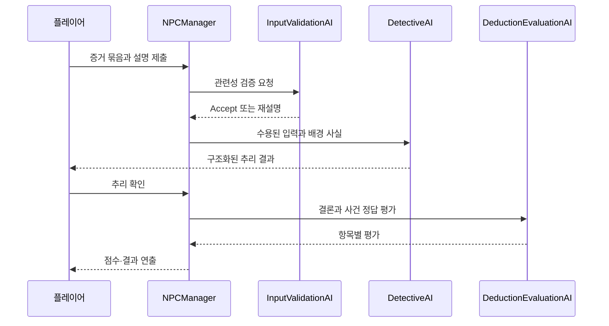

# 증거 검증·추리·평가 파이프라인

**담당자:** 최성원 — 역할별 AI 호출과 증거 입력·결과 연결 구현

## 코드



**InputValidationAI / DetectiveAI / DeductionEvaluationAI:** validate·deduce·evaluate 요청을 각자 전용 DTO로 처리합니다. **NPCManager:** 증거 제출과 사용자 확인 순서에 맞춰 호출합니다. **BackgroundFacts / CaseSolution / ResultData:** 배경 사실·사건 정답·결과 연출 설정을 분리합니다.

```csharp
// AI/DetectiveAI: 사진·물건·소리에서 추출한 공통 증거와 해석을 연결
[Serializable]
public class EvidenceRecord
{
    public List<EvidenceData> evidences;
    public string playerDescription;
}

[Serializable]
public class FinalDeductionInput
{
    public List<string> backgroundFacts;
    public List<EvidenceRecord> evidenceRecords;
}

// AISystem: 세 역할에 같은 통신 클라이언트를 주입
public AISystem(AIEdgeFunctionClient client)
{
    InputValidator = new InputValidationAI(client);
    Detective = new DetectiveAI(client);
    Evaluator = new DeductionEvaluationAI(client);
}

// 각 AI 클래스의 메서드 발췌: 공통 통신과 작업별 타입을 분리
// InputValidationAI: 설명과 증거의 관련성 검증 요청
public UniTask<EvidenceValidationResult> ValidateAsync(
    EvidenceValidationInput input, CancellationToken token = default)
    => client.InvokeAsync<EvidenceValidationResult>("validate", input, token);

// DetectiveAI: 플레이어 해석에 기반한 최종 추리 요청
public UniTask<FinalDeductionResult> DeduceAsync(
    FinalDeductionInput input, CancellationToken token = default)
    => client.InvokeAsync<FinalDeductionResult>("deduce", input, token);

// DeductionEvaluationAI: 사건 정답과 추리 결론의 항목별 평가 요청
public UniTask<DeductionEvaluationResult> EvaluateAsync(
    DeductionEvaluationInput input, CancellationToken token = default)
    => client.InvokeAsync<DeductionEvaluationResult>("evaluate", input, token);
```

```csharp
// NPCManager.SubmitRecordAsync / DoDeduction의 데이터 변환을 공통화
private EvidenceRecord BuildEvidenceRecord(OriginalEvidenceRecord original)
{
    // 사진 픽셀이나 소리를 AI에 보내는 대신, 수집 대상에 연결된 사실 데이터를 모은다.
    var evidences = new List<EvidenceData>();
    foreach (var item in original.collectiveEvidences) evidences.Add(item.data);
    foreach (var photo in original.photos) evidences.AddRange(photo.datas);
    foreach (var audio in original.audios) evidences.Add(audio.data);
    return new EvidenceRecord {
        evidences = evidences,
        playerDescription = original.playerDescription
    };
}

// 관련성 검증이 수용된 입력만 최종 추리에 전달
private async UniTask<FinalDeductionResult> ValidateAndDeduceAsync(
    OriginalEvidenceRecord original)
{
    var record = BuildEvidenceRecord(original);
    var ai = AISystemManager.Instance.AI;
    var validation = await ai.InputValidator.ValidateAsync(new EvidenceValidationInput {
        evidenceDatas = record.evidences,
        playerDescription = record.playerDescription
    });

    // Accept는 설명의 관련성이 수용됐다는 뜻이지 추론이 정답이라는 뜻은 아니다.
    if (validation.GetStatus() != InputStatus.Accept) return null;

    return await ai.Detective.DeduceAsync(new FinalDeductionInput {
        backgroundFacts = backgroundFacts.Facts,
        evidenceRecords = new List<EvidenceRecord> { record }
    });
}

// NPCManager.AcceptDeductionAsync: 플레이어가 추리를 확인한 뒤 평가 요청
private UniTask<DeductionEvaluationResult> EvaluateDeductionAsync(
    FinalDeductionResult deduction)
{
    return AISystemManager.Instance.AI.Evaluator.EvaluateAsync(
        // 입력 검증과 달리 이 단계는 생성된 결론과 작성된 사건 정답을 비교한다.
        new DeductionEvaluationInput { deduction = deduction, solution = solution });
}
```

```csharp
// NPCManager.AcceptDeductionAsync의 결과 분기만 발췌
// CalculateScore는 항목별 가중치, 함정 주장, 불명확 항목 감점을 반영
private void ApplyResult(DeductionEvaluationResult evaluation)
{
    // AI의 항목별 평가를 게임 규칙으로 점수화하고 에셋의 기준값으로 결과를 고른다.
    int score = CalculateScore(evaluation);
    List<string> response;
    Sprite sticker;
    if (score < resultData.NormalScore)
    {
        response = resultData.BadResponse;
        sticker = resultData.BadSticker;
    }
    else if (score < resultData.GoodScore)
    {
        response = resultData.NormalResponse;
        sticker = resultData.NormalSticker;
    }
    else
    {
        response = resultData.GoodResponse;
        sticker = resultData.GoodSticker;
    }

    resultText.text = score + " 점 / 100 점";
    resultSticker.sprite = sticker;
    // 원본은 response로 의뢰인 대사를 재생한 뒤 결과 화면을 표시
}
```

## 생략 및 재구성한 내용

- 원본: `1Seong/DetectiveAI`의 `Assets/Scripts/AI/` (AISystem, InputValidationAI, DetectiveAI, DeductionEvaluationAI), `UI/NPCManager.cs`, BackgroundFacts·CaseSolution·ResultData. 기준 커밋: `57848cd70415391109300ee33c4c1fdc3c3e1a25`.
- NPCManager의 중복된 증거 변환을 BuildEvidenceRecord로 묶고 검증·추리를 ValidateAndDeduceAsync, 사용자 확인 후 평가를 EvaluateDeductionAsync, 결과 표시를 ApplyResult로 재구성했습니다. 
- 원본에서는 originalEvidenceRecord.playerDescription에 입력창 값을 저장합니다. 
- 원본 NPCManager는 검증 실패 시 재설명 응답, 추리 실패 시 불명확 결론, 평가 실패 시 0점 DTO를 사용합니다. 이 UI·오류 대체 분기를 생략한 샘플에서는 예외가 호출자에게 전파됩니다.
- 최종 결론 DTO와 평가 DTO에는 범인·동기·장소·시간·접근 방법 등 9개 항목이 있습니다. 필드 전체 나열과 CalculateScore의 가중치·감점 계산, 입력 검증 상태 변환은 본문에서 생략했습니다.
- 원본은 제출 시 선택한 증거 묶음 하나를 최종 추리 입력에 넣습니다. 
- 사건 정답은 원본에서 CaseSolution 에셋으로 클라이언트에 존재하고 평가 요청에 포함됩니다. 
- DTO·AI 클래스의 필드와 생성자·using·Unity 참조·대사 및 비동기 UI를 생략했습니다. 각 블록은 서로 다른 클래스의 발췌이며 단독 실행되지 않습니다.
