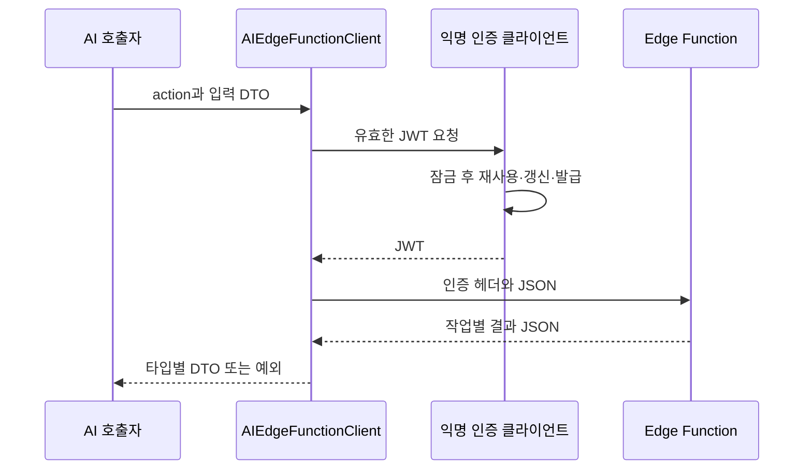

# 익명 세션과 서버 경유 AI 요청

**담당자:** 최성원 — 익명 인증 세션과 AI 서버 호출 클라이언트 구현

## 코드



**SupabaseAnonymousAuthClient:** 세션 재사용→갱신→익명 발급 순서로 토큰을 준비합니다. **AIEdgeFunctionClient:** 작업 종류와 입력을 서버로 보내고, 401이면 토큰을 무효화한 뒤 한 번 재시도합니다.

```csharp
// SupabaseAnonymousAuthClient: 동시 요청이 세션 발급·갱신을 중복 실행하지 않도록 직렬화
public async UniTask<string> GetAccessTokenAsync(CancellationToken token = default)
{
    // 잠금 대기 후 캐시를 다시 확인하므로 앞선 요청이 갱신한 토큰을 재사용할 수 있다.
    await sessionGate.WaitAsync(token);
    try
    {
        if (HasUsableAccessToken())
            return PlayerPrefs.GetString(AccessTokenKey);

        string refreshToken = PlayerPrefs.GetString(RefreshTokenKey, "");
        if (!string.IsNullOrWhiteSpace(refreshToken))
        {
            var refreshed = await RequestSessionAsync(
                $"{projectUrl}/auth/v1/token?grant_type=refresh_token",
                new JObject { ["refresh_token"] = refreshToken },
                token, allowAuthFailure: true);
            if (refreshed != null)
            {
                SaveSession(refreshed);
                return refreshed.access_token;
            }
            // 갱신이 인증 오류로 거절된 경우 기존 기록을 지우고 익명 세션을 새로 만든다.
            ClearSession();
        }

        var created = await RequestSessionAsync(
            $"{projectUrl}/auth/v1/signup", new JObject(),
            token, allowAuthFailure: false);
        SaveSession(created);
        return created.access_token;
    }
    finally
    {
        // 통신 실패나 취소가 발생해도 다음 요청이 잠금에 갇히지 않게 한다.
        sessionGate.Release();
    }
}

// 만료 60초 전부터 갱신 대상으로 처리
private bool HasUsableAccessToken()
{
    return !string.IsNullOrWhiteSpace(PlayerPrefs.GetString(AccessTokenKey, ""))
        && long.TryParse(PlayerPrefs.GetString(ExpiresAtKey, "0"), out long expiresAt)
        && expiresAt > DateTimeOffset.UtcNow.ToUnixTimeSeconds() + 60;
}
```

```csharp
// AIEdgeFunctionClient: 서버가 직접 반환한 작업별 JSON을 DTO로 변환
public async UniTask<T> InvokeAsync<T>(
    string action, object input, CancellationToken token = default)
{
    if (string.IsNullOrWhiteSpace(action))
        throw new ArgumentException("AI action is empty.");

    var payload = new JObject {
        ["action"] = action,
        ["input"] = input == null ? JValue.CreateNull() : JToken.FromObject(input)
    };
    string body = payload.ToString(Formatting.None);
    string accessToken = await authClient.GetAccessTokenAsync(token);
    var response = await SendAsync(body, accessToken, token);

    // 무한 재시도를 피하고 인증 복구를 한 번만 시도
    if (response.StatusCode == 401)
    {
        authClient.InvalidateAccessToken();
        accessToken = await authClient.GetAccessTokenAsync(token);
        response = await SendAsync(body, accessToken, token);
    }

    if (!response.Success)
        throw new AIEdgeFunctionException(
            response.StatusCode, response.RequestError, response.Body);

    // action별 응답을 해당 DTO로 읽어 UI가 JSON 필드명을 직접 다루지 않게 한다.
    T result = JsonConvert.DeserializeObject<T>(response.Body);
    if (result == null) throw new InvalidOperationException("AI response is null.");
    return result;
}

// Unity 클라이언트는 OpenAI 키 대신 익명 사용자 JWT로 서버 함수를 호출
private async UniTask<EdgeHttpResponse> SendAsync(
    string body, string accessToken, CancellationToken token)
{
    using var request = new UnityWebRequest(functionUrl, UnityWebRequest.kHttpVerbPOST);
    request.uploadHandler = new UploadHandlerRaw(Encoding.UTF8.GetBytes(body));
    request.downloadHandler = new DownloadHandlerBuffer();
    request.SetRequestHeader("Content-Type", "application/json");
    request.SetRequestHeader("apikey", publishableKey);
    request.SetRequestHeader("Authorization", $"Bearer {accessToken}");
    await request.SendWebRequest().ToUniTask(cancellationToken: token);
    return new EdgeHttpResponse {
        Success = request.result == UnityWebRequest.Result.Success,
        StatusCode = request.responseCode,
        RequestError = request.error,
        Body = request.downloadHandler?.text
    };
}
```

## 생략 및 재구성한 내용

- 원본: `1Seong/DetectiveAI`의 `Assets/Scripts/AI/AIEdgeFunctionClient.cs`, `SupabaseAnonymousAuthClient.cs`, `AISystemManager.cs`. 기준 커밋: `57848cd70415391109300ee33c4c1fdc3c3e1a25`.
- 생성자·설정 필드·세션 DTO·인증 HTTP 요청·세션 저장/삭제·오류 DTO 파싱을 생략했습니다. 원본 RequestSessionAsync는 allowAuthFailure가 true이고 4xx일 때 null을 반환하고, 그 외 실패는 예외로 전달합니다.
- functionUrl은 프로젝트 URL에 /functions/v1/detective-ai를 붙입니다. 실제 프로젝트 주소·키·JWT·프롬프트는 샘플에 넣지 않았습니다.
- 입력 데이터가 정상이고 세션이 유효한 경우의 흐름을 중심으로 변수명을 줄였습니다. Newtonsoft.Json·UniTask·UnityWebRequest·생략한 필드/보조 메서드가 필요하며 단독 실행되지 않습니다.
- OpenAIClient·OpenAIRequestBuilder·OpenAIResponseParser의 직접 호출 경로는 현재 AISystem이 사용하는 Edge Function 경로와 구분해 제외했습니다. 서버 원문 응답 처리와 클라이언트 DTO 변환을 혼동하지 않도록 했습니다.
