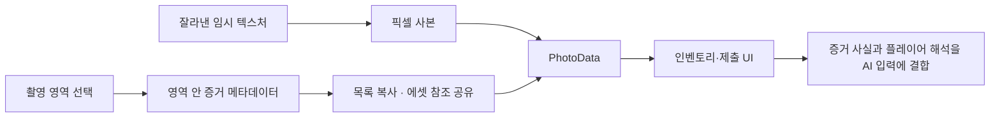

# 사진·물건·소리의 증거 수집과 보관

**담당자:** 최성원 — 증거 수집, 사진 데이터와 인벤토리 연결 구현

## 코드



**EvidenceData:** AI에 전달할 식별자와 사실을 담습니다. **ScreenShotSelectionController:** 촬영 영역 안의 증거를 모읍니다. **PhotoDataHelper / InventoryManager:** 사진과 메타데이터를 보관하고 텍스처를 해제합니다. **SoundSource / CollectiveEvidence:** 클릭 수집을 인벤토리로 연결합니다.

```csharp
public class EvidenceData : ScriptableObject
{
    public string evidenceId;
    public string fact; // 단서의 객관적 사실이며 플레이어가 작성하는 해석과 분리
}

[Serializable]
public class PhotoData
{
    public Texture2D tex;
    public List<string> descs;
    public List<EvidenceData> datas;
}

// ScreenShotSelectionController: 선택 사각형에 중심점이 들어온 증거 수집
private void CaptureObjects(Rect rect)
{
    foreach (var target in InventoryManager.instance.GetPhotoEvidences())
    {
        Vector3 p = target.position;
        if (p.x < rect.xMin || p.x > rect.xMax
            || p.y < rect.yMin || p.y > rect.yMax) continue;

        // 같은 사진에 여러 단서가 들어오면 각각의 데이터와 표시 설명을 함께 모은다.
        var evidence = target.GetComponent<EvidenceObject>();
        evidences.Add(evidence.data);
        descs.Add(evidence.desc);
    }
}

// 촬영 화면이 닫히며 임시 텍스처를 해제하기 전에 별도 사본 저장
public void SaveImage()
{
    InventoryManager.instance.AddPhoto(
        PhotoDataHelper.CreatePhotoData(croppedTexture, evidences, descs));
    // 가방 이동 연출과 촬영 모드 종료는 생략
}
```

```csharp
// PhotoDataHelper: 목록은 복사하지만 EvidenceData 에셋 참조는 공유
public static PhotoData CreatePhotoData(Texture2D texture,
    List<EvidenceData> evidences, List<string> descriptions)
{
    return new PhotoData {
        tex = CopyTexture(texture),
        datas = evidences == null ? new() : new List<EvidenceData>(evidences),
        descs = descriptions == null ? new() : new List<string>(descriptions)
    };
}

private static Texture2D CopyTexture(Texture2D source)
{
    if (source == null) return null;
    var copy = new Texture2D(source.width, source.height,
        source.format, source.mipmapCount > 1);
    // 임시 촬영 텍스처가 해제돼도 보관 사진이 남도록 픽셀 버퍼를 별도로 만든다.
    copy.SetPixels(source.GetPixels());
    copy.Apply();
    copy.filterMode = source.filterMode;
    copy.wrapMode = source.wrapMode;
    copy.anisoLevel = source.anisoLevel;
    copy.name = $"{source.name}_Copy";
    return copy;
}

// InventoryManager: 보관용 셀과 추리 제출용 셀에 같은 사진 데이터 연결
public void AddPhoto(PhotoData photo)
{
    photos.Add(photo);
    Instantiate(photoUIPrefab, photoUIParent).GetComponent<PhotoUICell>().Init(photo);
    Instantiate(deductionPhotoCellPrefab, deductionPhotoParent)
        .GetComponent<SubmitPhotoUICell>().Init(photo);
}

// 원본 OnDestroy 중 사진 리소스 해제 부분
private void ReleasePhotos()
{
    foreach (var photo in photos)
    {
        if (photo?.tex == null) continue;
        Destroy(photo.tex);
        // 해제된 텍스처를 이후 UI나 정리 코드가 다시 사용하지 않도록 참조도 비운다.
        photo.tex = null;
    }
}
```

```csharp
// SoundSource.OnClick: 소리 증거를 중복 획득하지 않도록 상태 기록
public void OnClick()
{
    if (isCollected) return;
    InventoryManager.instance.AddSound(this);
    isCollected = true;
    GetComponent<Button>().enabled = false;
}

// CollectiveEvidence.OnClick: 물건 수집은 버튼을 비활성화하고 가방으로 연출
public void CollectItem()
{
    InventoryManager.instance.AddCollectible(this);
    GetComponent<Button>().enabled = false;
    GetComponent<ButtonHoverScale>().enabled = false;
    // 원본 DOTween 연출 후 오브젝트를 비활성화
}
```

## 생략 및 재구성한 내용

- 원본: `1Seong/DetectiveAI`의 `Assets/Scripts/Evidence/` (EvidenceData, EvidenceObject, PhotoData, InventoryManager, SoundSource, CollectiveEvidence), `UI/ScreenShotSelectionController.cs`. 기준 커밋: `57848cd70415391109300ee33c4c1fdc3c3e1a25`.
- ScreenShotSelectionController의 캡처·드래그 크기 제한·이미지 자르기·UI 좌표 변환·연출은 생략하고 증거 메타데이터 연결을 남겼습니다. 
- CopyEvidenceDatas·CopyDescriptions의 반복문은 List 생성자로 축약했습니다. Texture2D는 별도로 복사하지만 ScriptableObject까지 복제하는 깊은 복사는 아닙니다. 
- 원본은 촬영 모드 종료 시 임시 촬영/자르기 텍스처를, 사진 삭제와 InventoryManager.OnDestroy에서 보관 사본을 해제합니다. ReleasePhotos는 OnDestroy 일부를 분리한 설명용 함수이며, 사진 삭제의 UI·디졸브 연출은 생략했습니다.
- CollectItem은 CollectiveEvidence.OnClick의 발췌용 이름입니다. 소리의 주기 재생과 수집 모드 전환, 물건 애니메이션, 동일한 인벤토리 셀 생성 반복은 제외했습니다.
- EvidenceRecorder의 목록 저장은 사용하지 않고 NPCManager에서 실제 제출하는 경로를 AI 샘플에서 다룹니다. 
- 필드·using·상속 선언·Unity UI 프리팹 참조와 컴포넌트 설정을 생략했습니다. 여러 클래스의 메서드를 나란히 둔 설명용 발췌로 단독 실행되지 않습니다.
